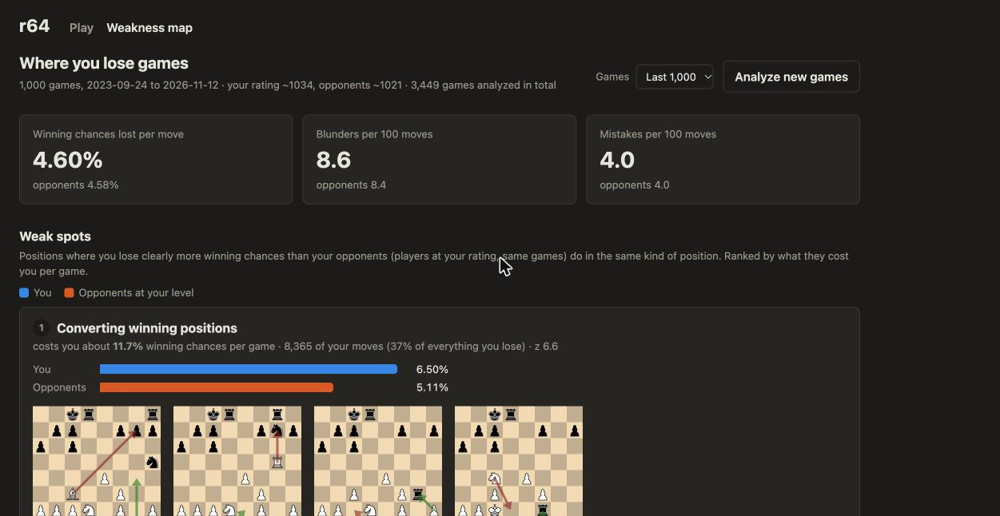
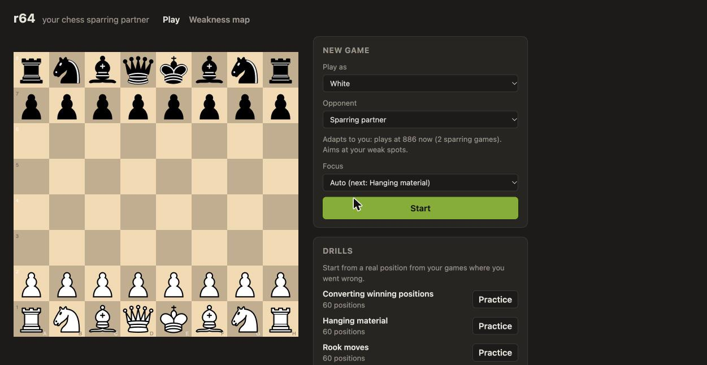

# r64 ♟️

**A chess bot that plays like a human at your level, finds the positions where you lose, and trains you on them.**

Stockfish is too strong to learn from, and most bots blunder in ways no human would. r64 plays like a
real 600–2200 player (mistakes included), studies your own games from chess.com and lichess, and steers
sparring games into the exact kinds of positions you keep losing.



## What it does

- **Human-like bot.** A neural network trained on 200k lichess games predicts the move a human at a
  given rating would play **45% of the time** (Maia, the research benchmark, gets about 51%).
- **Weakness map.** Stockfish analyzes your games and compares you with your opponents *in the same
  games*: "you lose 6.5% winning chances per move when converting winning positions; players at your
  rating lose 5.1%." Each weak spot comes with real positions from your games.
- **Targeted sparring.** The sparring partner steers games toward your weak spots and adjusts its
  rating to keep you scoring around 50%.
- **Drills.** Start from real positions where you went wrong and play them out again.
- **Personal model.** Fine-tuned on your games, it plays like *you*, and it retrains as you play.

Everything runs locally. Your games never leave your machine.



## Quick start (about 3 minutes)

Requires [uv](https://docs.astral.sh/uv/) and [Stockfish](https://stockfishchess.org/).

```bash
git clone https://github.com/DavidAndree/r64-chess-engine && cd r64-chess-engine
brew install stockfish           # or your platform's package
uv sync
uv run python -m r64.model download   # pretrained human-like model (2.4 MB)
uv run python -m r64.server           # open http://127.0.0.1:8064
```

That's enough to play the human-like bot at any rating. To get your weakness map, sparring and drills,
import your games:

```bash
# put in your usernames; leave out a site you don't use
uv run python -m r64.data import-mine --chesscom YOUR_CHESSCOM_NAME --lichess YOUR_LICHESS_NAME
uv run python -m r64.data encode-mine
uv run python -m r64.analysis analyze     # Stockfish over your games (about 1 s per game per core)
uv run python -m r64.model personal       # your personal model (a few minutes)
```

Training uses the Apple GPU on Apple Silicon Macs, or CUDA where available.

### Train the base model yourself (optional)

```bash
uv run python -m r64.data lichess-db --month 2026-10 --games 200000 --name lichess-base
uv run python -m r64.model train --data data/positions/lichess-base --name base --epochs 2
```

A few hours on a laptop. The server works at any stage: without a model you can still play Stockfish.

Built with [python-chess](https://github.com/niklasf/python-chess), PyTorch, FastAPI,
[chessground](https://github.com/lichess-org/chessground) and Stockfish. Inspired by
[Maia](https://www.maiachess.com/).

## What's on the page

- **Play** (`/`): choose the sparring partner, the human-like bot, your personal model, or
  Stockfish. The page also has drills and the status of your personal model.
- **Weakness map** (`/weakness`): your weak spots and strengths compared with your opponents, plus
  example positions, a monthly trend, opening results and mistake types.

## Other commands

| Command | What it does |
|---|---|
| `uv run python -m r64.model download` | Download the pretrained base model |
| `uv run python -m r64.model evaluate` | Base model accuracy by rating band |
| `uv run python -m r64.model match bot:1200 bot:1800` | Play two opponents against each other |
| `uv run python -m r64.model learning-curve` | Personal model accuracy vs number of your games |
| `uv run python -m r64.analysis report` | The weakness map as text |
| `uv run python -m r64.sparring_sim` | Measure how much steering focuses games |

Games are stored in `data/r64.sqlite`, and models in `checkpoints/`. Both are git-ignored. Set
`R64_DB` to use another games database, or `R64_BOT` to use another base model.

## Layout

```
r64/data/       game downloads, PGN parsing, position encoding
r64/model/      network, training, bots, personal model
r64/analysis/   Stockfish analysis and the weakness map
r64/sparring*   steering, adaptive level, drills
r64/server/     web server
web/            browser UI
tests/          tests
```

See [PLAN.md](PLAN.md) for the design.

## Contributing

Issues and pull requests are welcome. Run `uv run pytest` and `uv run ruff check` before opening a PR.
If r64 helped your game, a ⭐ helps other players find it.

## License

[GPL-3.0-or-later](LICENSE).
